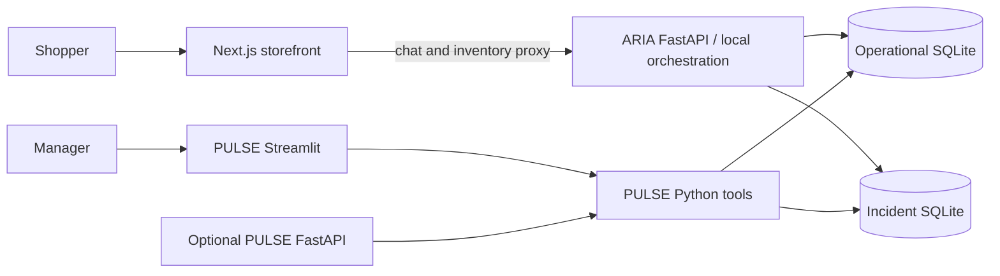
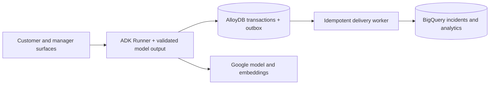

# ARC architecture — local prototype and planned cloud integration

Updated October 18, 2026 · Specification 1.1

## 1. Executable topology

The launcher starts the storefront, ARIA and Streamlit. The dashboard invokes
Python tools directly; it does not call `PULSE_AGENT_URL` or require the optional
PULSE HTTP service. The two Python processes share absolute database paths.
Without those paths each process has its own in-memory state.

## 2. Responsibilities and sources

| Component | Implementation | Responsibility |
|---|---|---|
| Storefront | `frontend/aria-app` | Browse current inventory, edit basket, collect explicit feedback and display errors |
| ARIA API | `agents/aria/main.py` | Session lifecycle, supported constraint handling, quote review, checkout and incident writes |
| Pricing | `tools/shared/pricing.py` | Canonical product rows, quantity validation, consolidation and quote construction |
| Operational adapter | `tools/shared/alloydb_client.py` | Memory or SQLite transactions, stock, orders, sessions and decisions |
| Incident adapter | `tools/shared/bigquery_client.py` | Memory or SQLite upserts and windowed aggregation |
| Demand intelligence | `tools/pulse_tools/demand_intelligence.py` | Evidence counts, action options, decisions and descriptive outcome monitoring |
| PULSE provider/UI | `frontend/pulse-dashboard` | Store/window selection, evidence, manager controls and timed refresh |
| Optional HTTP analysis | `agents/pulse/main.py` | Analysis and demand/discount decision endpoints for API clients |

## 3. Shopper execution

1. Validate a UUID session, customer profile and store binding.
2. Parse supported English constraints. Explicit diet/budget override defaults;
   exclusions persist within the session. Unknown shopping requests ask for clarification.
3. Build affordable in-stock lines and retain explicitly requested unavailable products.
4. Offer a dietary-safe alternative within the caller's price ceiling. TF-IDF
   similarity, price-band preference and purchase history rank candidates.
5. Accept explicit substitution feedback. Add the accepted alternative, preserve
   the original request and record whether it is satisfaction or compromise.
6. Quote canonical current inventory prices and eligible category discounts.
7. On exact confirmation, require the current quote ID. A changed manual basket
   or changed quote is returned for another review instead of being ordered.
8. Atomically decrement stock, consume promotion usage once and insert the order.
9. Upsert the incident, preserve evidence, persist the session and return the result.

An already ordered session returns its order on retry. Cancellation closes the
session without ordering. The storefront always uses ARIA; there is no scripted
success fallback. Its receipt snapshot uses browser session storage; this is not
a server-backed order-history or authentication product.

## 4. Transactions and consistency

The local operational adapter stores one JSON state snapshot in `arc_state`.
Public operations run under a reentrant lock and transaction. SQLite uses
`BEGIN IMMEDIATE` to serialize processes; nested operations participate in the
outer transaction. Callers receive copies to prevent out-of-transaction mutation.

The incident adapter uses a second SQLite database with one row per session.
Feedback and checkout update that row while preserving its original timestamp.
The databases must have different resolved paths to avoid competing write locks.

Operational rollback covers stock, promotion counters, order and session state.
Incident delivery is a separate transaction, so this prototype does not guarantee
atomicity across both stores. A production implementation should commit an outbox
entry with the order and deliver it to analytics with an idempotent consumer.
Do not treat the local incident table as an immutable event stream.

## 5. Demand interpretation

Customer feedback produces structured evidence with an original product,
optional substitute, outcome, statement, source and certainty. The local parser
is deliberately conservative and rule-based; UI selections supply explicit feedback.
Unknown language stays unknown. `fulfilled` requires a confirmed order containing
the requested original product; availability alone is insufficient.

A session can complete with an order and still contain a `compromise` signal.
PULSE counts each product/session once and separates explicit unresolved demand
from satisfied alternatives and unknown outcomes. Historical synthetic sessions
remain labeled. This is product-level unmet-intent analysis, not a measured lost
unit forecast or causal estimate.

## 6. Actions and observation

- Demand proposals use `demand:{store}:{product}:{business_date}` keys.
- Transfer and replenish require at least three explicit unresolved signals.
- Transfer quantity is capped by source stock above its reorder threshold. The
  approved transfer is an atomic **local simulation**, not a carrier instruction.
- Replenish creates a PO draft. PO review remains separate; no delivery is invented.
- Defer records a decision to observe without changing inventory.
- Demand decisions record baseline counts and evidence-session IDs. The monitor
  counts product-request sessions whose preserved first timestamp is after the
  decision. A pre-existing session updated later is not a new post-action session.
- PO deduplication reuses pending, approved or rejected records for 24 hours.
- Discount decisions use store/product/expiry-batch keys; approval writes the
  selected discount to store inventory. Rejection leaves the price unchanged.

PULSE renders persisted decisions, not session-state success overrides. Operational
failures display errors. Timed Streamlit fragments refresh without a blocking sleep.
The storefront refreshes inventory every ten seconds.

## 7. Existing analytics boundaries

Stockout patterns default to five incidents in 48 hours. Root-cause classification
uses replenishment timing/volume heuristics and provides a hypothesis, not causal
proof. Forecasting uses current stock and a synthetic daily-velocity assumption;
its confidence number is an illustrative fixture, not statistical calibration.

Legacy financial calculations assume a 48-hour observation period, a 15% margin
factor and a seven-day horizon. In particular, changing the dashboard window to
168 hours does not recalibrate that financial formula. Financial outputs remain
labeled scenario estimates and are not the outcome monitor's success metric.

The optional PULSE `/pulse/analyze` path currently requests 120-unit PO drafts.
The dashboard derives quantities from incident counts/reorder thresholds; demand
actions use their own explicit-signal and source-safety policy. These callers
share storage and PO deduplication but are not identical execution plans.

## 8. Planned Google integration

ADK agent definitions/tool bindings and prompt files are scaffolding. The HTTP
handlers do not run an ADK Runner. Real AlloyDB, BigQuery, LLM, embedding and
vector adapters remain unimplemented. `USE_MOCK=false` yields an explicit 501 on
chat/analysis; other deferred adapter paths can raise `NotImplementedError`.
Liveness responses alone are not evidence of cloud readiness.

Future integration must preserve the quote and evidence contracts, use shared
managed storage across instances, implement application authorization and verified
cloud identity audiences, and evaluate model output before enabling business actions.
Cloud Run/Firebase deployment and external logistics/payment/supplier execution
remain outside the current branch.

See [DEPLOYMENT.md](DEPLOYMENT.md) and [AGENT_CONTRACTS.md](AGENT_CONTRACTS.md).
