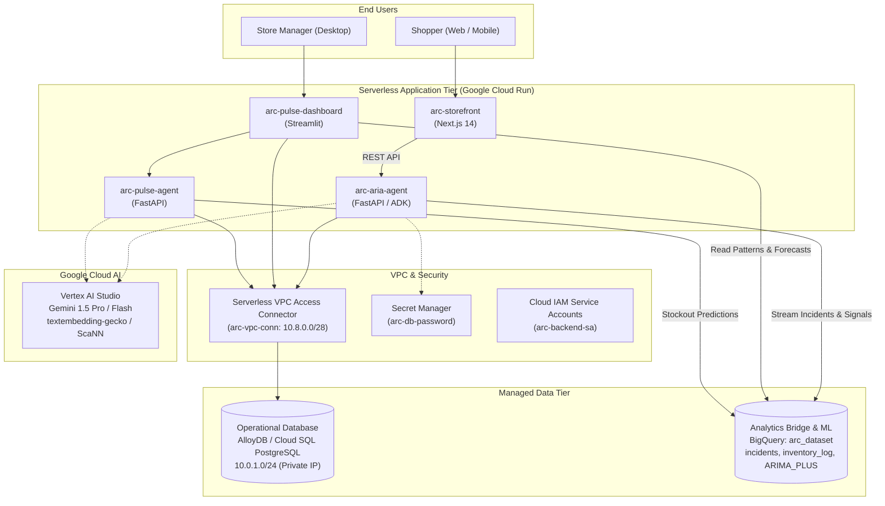

# ARC Google Cloud Infrastructure Architecture & Deployment Guide

This document specifies the complete Google Cloud infrastructure for **ARC (Agentic Retail Command)**, bridging customer shopping intent with store operational decisions.

---

## 1. Cloud Architecture Topology



---

## 2. Infrastructure Components

### 2.1. Compute & Frontend (Cloud Run)
All compute runs serverless on **Google Cloud Run**, containerized and scaled dynamically:
1. **`arc-storefront`**: Customer shopping web interface built with Next.js 14. Proxies requests to ARIA.
2. **`arc-aria-agent`**: Customer-facing conversational grocery assistant. Manages sessions, constraints (diet, budget), quotes, idempotency, and records customer demand signals.
3. **`arc-pulse-dashboard`**: Store manager operational dashboard built with Streamlit. Surfaces unmet customer demand, stockouts, perishable goods discounts, and transfer approvals.
4. **`arc-pulse-agent`**: Background operational intelligence service running pattern detection and draft purchase order generation.

### 2.2. Operational Database (AlloyDB / Cloud SQL PostgreSQL)
- **Primary Schema**: Stores, Customer Profiles, Suppliers, Inventory (with vector embeddings), Orders, Promotions, Replenishment Schedules, Purchase Orders, and Manager Decisions.
- **Connection Security**: Enforced on Private IP within the VPC, accessible to Cloud Run services exclusively through a **Serverless VPC Access Connector** (`10.8.0.0/28`).
- **AlloyDB vs Cloud SQL Choice**:
  - **Hackathon Mode (Default)**: `use_cloud_sql = true`, `enable_alloydb = false` (`db-f1-micro` or `db-custom-1-3840`) to minimize development costs.
  - **Enterprise Mode**: `enable_alloydb = true` enables AlloyDB ScaNN indexing for 768-dimensional product embeddings.

### 2.3. Analytics Bridge (BigQuery & BigQuery ML)
- **Dataset**: `arc_dataset` (Region: `asia-southeast1`).
- **Tables**:
  - `incidents`: Partitioned by `DATE(timestamp)`, clustered by `store_id, session_sentiment`. Captures shopper sessions, unavailable items, customer statements, and explicit compromise/satisfaction feedback.
  - `inventory_log`: Partitioned by `DATE(logged_at)`, clustered by `store_id, event_type`.
  - `promotion_log`: Partitioned by `DATE(logged_at)`, clustered by `promotion_id`.
- **BigQuery ML**: `arc_dataset.demand_forecast` time-series forecasting using `ARIMA_PLUS` on daily incident volumes.

### 2.4. Google AI / Vertex AI
- Foundation Models: `gemini-1.5-pro` (complex reasoning, catalog mapping) and `gemini-1.5-flash` (low-latency intent extraction).
- Vector Search / Embeddings: `textembedding-gecko@003` / `text-embedding-004`.

---

## 3. Directory Structure

```
├── terraform/                   # Infrastructure as Code (IaC)
│   ├── versions.tf              # Provider constraints (google, google-beta, random)
│   ├── variables.tf             # Configurable parameters (project_id, region, tiers)
│   ├── apis.tf                  # Automated enablement of 15 Google Cloud APIs
│   ├── network.tf               # VPC, Subnet, Private IP Peering, Serverless VPC Connector
│   ├── security.tf              # Secret Manager and Cloud IAM Service Accounts
│   ├── database.tf              # Cloud SQL & AlloyDB PostgreSQL provisioning
│   ├── bigquery.tf              # BigQuery dataset, tables, partitioning, and schemas
│   ├── registry.tf              # Artifact Registry Docker repository
│   ├── cloud_run.tf             # 4 Cloud Run services with VPC egress & secrets
│   ├── outputs.tf               # Live URLs, database IPs, and resource IDs
│   └── terraform.tfvars.example # Ready-to-use variable values
│
├── cloudbuild.yaml              # Cloud Build pipeline for parallel container builds
│
├── agents/
│   ├── aria/Dockerfile          # Production container for ARIA Agent
│   └── pulse/Dockerfile         # Production container for PULSE Agent
│
├── frontend/
│   ├── aria-app/Dockerfile      # Multi-stage standalone Next.js container
│   └── pulse-dashboard/Dockerfile # Streamlit dashboard container
│
└── scripts/
    ├── setup_gcp_project.sh     # Project verification, billing link, API enablement
    ├── init_gcp_db.py           # Loads schemas & seeds into BigQuery & PostgreSQL
    └── deploy_gcp.sh            # One-click master deployment script
```

---

## 4. Cost Optimization Strategy for Hackathons

| Component | Default Hackathon Setting | Cost Impact |
|---|---|---|
| **Cloud Run Services** | `min_instances = 0`, `max_instances = 3` | **$0.00** when idle. Only incurs costs during live requests. |
| **Operational Database** | Cloud SQL `db-f1-micro` (`enable_alloydb = false`) | ~**$8.00 / month** (~$0.25/day during hackathon), compared to $150+/month for AlloyDB. |
| **BigQuery** | Serverless on-demand pricing | **$0.00** within 1 TB/month free query tier and 10 GB storage. |
| **Artifact Registry** | Standard storage | < **$0.10** for container images. |
| **VPC Connector** | 2 micro instances (e2-micro) | Incurred only while active; easily torn down. |

---

## 5. Deployment Instructions

### Prerequisites
- Google Cloud CLI (`gcloud`) installed and logged in (`gcloud auth login`).
- Active Google Cloud project: `aria-mira-retail` (or your project ID).
- An active Google Cloud Billing Account.

### Step 1: Configure Project & Enable APIs
```bash
./scripts/setup_gcp_project.sh aria-mira-retail asia-southeast1
```

### Step 2: Build & Push Container Images
Build all service containers in parallel using Google Cloud Build:
```bash
gcloud builds submit --config=cloudbuild.yaml --substitutions=_REGION=asia-southeast1
```

### Step 3: Provision Infrastructure with Terraform
```bash
cd terraform
cp terraform.tfvars.example terraform.tfvars
terraform init
terraform apply
```

### Step 4: Seed Database & BigQuery Schemas
```bash
.venv/bin/python scripts/init_gcp_db.py
```

### Step 5: Access Live URLs
Terraform outputs your public HTTPS endpoints:
- **Customer Storefront**: `https://arc-storefront-xxxx-as.a.run.app`
- **Manager Dashboard**: `https://arc-pulse-dashboard-xxxx-as.a.run.app`
- **ARIA Agent API**: `https://arc-aria-agent-xxxx-as.a.run.app`
- **PULSE Agent API**: `https://arc-pulse-agent-xxxx-as.a.run.app`
